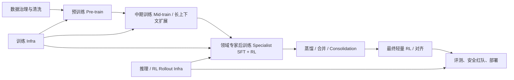

> 资料来源：
> - `DeepSeek_V4.pdf`
> - `微软新推理模型MAI-Thinking-1技术报告英中对照版(1).pdf`
>
> 阅读目标：从两份工业技术报告中学习一个现代大模型从数据、架构、预训练、中期训练、后训练/RL、推理与训练基础设施、安全评测到发布形态的完整工程链路。

## 0. 先给结论：工业界不是“只训练一个模型”

这两篇报告共同展示了一个很清晰的工业训练范式：

工业界真正做的是一个系统：

- **数据系统**：爬取、购买、授权、OCR、抽取、分类、去重、去污染、质量打分、混合比例搜索。
- **模型架构系统**：MoE、长上下文注意力、路由、归一化、初始化、优化器共同设计。
- **预训练系统**：大规模 token 训练，控制数据混合、学习率、batch、稳定性、并行策略。
- **中期训练系统**：把模型从“会语言建模”推向“擅长代码、数学、STEM、长上下文”的阶段。
- **后训练系统**：SFT、GRPO/RL、奖励模型、验证器、工具环境、agent 环境、安全数据、蒸馏与合并。
- **基础设施系统**：ZeRO、EP、CP、FSDP、FP8/FP4、kernel、checkpoint、故障恢复、rollout、sandbox。

DeepSeek-V4 和 MAI-Thinking-1 的侧重点不同：

| 维度 | DeepSeek-V4 | MAI-Thinking-1 |
|---|---|---|
| 核心形态 | 两个开源稀疏 MoE：V4-Pro 与 V4-Flash | 一个 reasoning-first 模型 MAI-Thinking-1，基座为 MAI-Base-1 |
| 模型规模 | V4-Pro：1.6T 总参数 / 49B 激活；V4-Flash：284B 总参数 / 13B 激活 | MAI-Base-1：约 962B 总参数 / 34.7B 激活 |
| 上下文 | 1M tokens | 目标 256K，上下文扩展方法可推广到 1M+ |
| 训练 token | Flash 32T；Pro 33T | 30T 预训练 + 3.55T 中期训练 |
| 架构重点 | mHC、混合注意力 CSA/HCA、DeepSeekMoE、Muon、低 KV cache | LatentMoE、局部/全局注意力 5:1、dropless MoE、YOLO infra |
| 后训练重点 | 多专家 specialist、GRPO、Generative Reward Model、OPD、多教师合并、FP4 QAT、1M RL | 三条 RL climb：STEM/竞赛编程、Agentic SWE/tool-use、Helpfulness/Safety；最后 consolidation |
| Infra 重点 | MegaMoE、TileLang、确定性 kernel、KV cache 管理、DSec sandbox | YOLO 训练框架、Rocket RL、8K GB200 集群、SGLang 推理、权重传输 |

## 1. 必须先理解的术语

### 1.1 MoE：总参数大，激活参数小

Mixture-of-Experts (MoE) 把 FFN 层拆成很多专家。每个 token 只路由到少量专家，所以：

- **总参数**决定模型能存多少知识和模式。
- **激活参数**决定单 token 前向实际用多少计算。
- 例如 DeepSeek-V4-Pro 有 1.6T 总参数，但每个 token 只激活 49B；MAI-Base-1 约 962B 总参数，激活 34.7B。

工业意义：可以用相对低的单次推理 FLOPs 获得非常大的参数容量。但代价是路由、负载均衡、all-to-all 通信、专家并行和 kernel 优化都变得非常关键。

### 1.2 Pre-train / Mid-train / Post-train 的边界

| 阶段 | 目标 | 训练数据 | 常用目标 |
|---|---|---|---|
| 预训练 Pre-train | 学语言、代码、知识、基本推理分布 | 超大规模通用数据：web、code、PDF、books、STEM、多语言 | next-token prediction |
| 中期训练 Mid-train | 把能力朝特定方向增强，常见是长上下文、代码、数学、STEM | 从预训练数据中重筛、重加权，也可能做长序列 repacking | 仍以 next-token prediction 为主 |
| 后训练 Post-train | 让模型会遵循指令、推理、用工具、安全回答 | SFT 数据、RL prompt、可验证题、偏好数据、agent 环境轨迹 | SFT、RL/GRPO、奖励模型、蒸馏 |

MAI 报告非常强调：**mid-training 不一定引入新数据，也不一定引入合成数据，而是重新过滤和重加权已有 corpus**。DeepSeek 报告则更强调：**post-training 中通过多专家、OPD、RL rollout 和工具环境把能力激活并合并**。

### 1.3 Decontamination、Dedup、Data Mix

- **Dedup 去重**：去掉完全重复、近似重复、语义重复，避免模型靠重复记忆降低 loss。
- **Decontamination 去污染**：移除 benchmark、考试题、SWE-bench 等评测相关数据，避免评测作弊。
- **Data mix 数据混合**：决定 30T 训练 token 中 code、STEM、web、PDF、book、多语言各占多少。

MAI 的一个关键经验：小模型/短训练的 data mix 排名不一定能外推到大模型/长训练。小规模 stem-heavy mix 更好，但到 23B/20T 规模时 code-heavy mix 更好，因为部分 STEM 源质量高但多样性不足、近似重复多。

### 1.4 ZeRO、EP、CP、FSDP

- **ZeRO**：把参数、梯度、优化器状态分片，降低单卡显存。
- **FSDP / ZeRO-3**：参数在用时 all-gather，用完释放，显存省但通信更多。
- **EP Expert Parallelism**：MoE 专家分布在不同 GPU 上，token 通过 all-to-all 发给对应专家。
- **CP Context Parallelism**：长上下文序列在多个 GPU 上切分，减少单卡序列长度压力。

工业训练里，这些不是附属细节，而是决定模型能不能训练起来的核心设计。

### 1.5 GRPO 与 RL climb

GRPO (Group Relative Policy Optimization) 是 DeepSeek-R1 系列后被广泛采用的一类 RL 方法。核心思路：

- 对同一个 prompt 采样一组回答。
- 用验证器、奖励模型或 judge 给每条轨迹打分。
- 不一定需要 value model，而是用组内相对优势更新策略。

MAI 和 DeepSeek 都使用 GRPO 或类似 RL 技术，但两者后训练组织方式不同：

- DeepSeek：多 specialist，再用 OPD 合并。
- MAI：三个大型 RL climb，再 consolidation SFT 和轻量最终 RL。

## 2. 两个模型的总览

### 2.1 DeepSeek-V4

DeepSeek-V4 报告介绍两个 MoE 模型：

| 模型 | 总参数 | 激活参数 | 上下文 | 预训练 token | 定位 |
|---|---:|---:|---:|---:|---|
| DeepSeek-V4-Flash | 284B | 13B | 1M | 32T | 更低成本、推理更便宜 |
| DeepSeek-V4-Pro | 1.6T | 49B | 1M | 33T | 更强能力，Max reasoning 模式达到开放模型 SOTA |

DeepSeek-V4 的核心主张：

- 通过 **mHC**、**混合注意力**、**Muon 优化器**和新的 MoE 训练策略，提高性能、训练稳定性和长上下文效率。
- 在 1M 上下文下，V4-Pro 相比 DeepSeek-V3.2 只需要约 **27% 单 token FLOPs** 和 **10% KV cache**；V4-Flash 进一步降低到 **10% FLOPs** 和 **7% KV cache**。
- 把 routed expert 参数做 FP4，继续降低推理和训练成本。
- 后训练用 specialist training、GRPO、Generative Reward Model、OPD、多教师合并和 1M RL infra。

### 2.2 MAI-Thinking-1

MAI-Thinking-1 是 Microsoft AI 报告中的 reasoning 模型，基座 MAI-Base-1 从零训练。

| 项目 | 内容 |
|---|---|
| 基座模型 | MAI-Base-1 |
| 参数 | 约 962B 总参数 / 34.7B 激活 |
| 架构 | Decoder-only Transformer + sparse MoE |
| 训练硬件 | 单一逻辑集群、一个站点、8K GB200 GPUs |
| 数据原则 | 公开与授权的人类生成数据；不使用第三方蒸馏；预训练不用 LM 生成合成数据 |
| 预训练 | 30T tokens，16K context |
| 中期训练 | 3.4T tokens at 64K + 150B tokens at 256K |
| 后训练 | STEM/竞赛编程、Agentic SWE/tool-use、Helpfulness/Safety 三条 climb，再合并 |

MAI 报告最有学习价值的地方在于它把工业训练 pipeline 讲得很细：数据治理、data mix 搜索、YOLO 训练框架、Rocket RL、集群运维、长上下文扩展、SWE 环境构造、安全红队。

## 3. 数据工程：工业训练的第一核心

### 3.1 MAI 的数据治理原则

MAI 数据来源包括：

- Web HTML / Web PDFs
- Public GitHub code
- Books and journals
- 公开或授权的人类生成数据

明确排除：

- 不使用开源训练数据集作为直接来源。
- 不使用第三方模型蒸馏。
- 预训练不使用语言模型生成的合成数据。
- 不使用私有客户/产品数据，除非有 opt-in 或协议。
- 排除或过滤 PII、安全风险、成人内容、政策不合规内容。
- 遵守 robots/meta 等站点信号。
- 排除 USTR notorious markets 等高风险来源。
- 排除 ML 代码仓库，例如 HuggingFace 相关仓库，以降低污染和模型生态自我污染风险。

MAI 报告给出的数据 cutoff：

| 数据类型 | 截止时间 |
|---|---|
| Web HTML | 2025-09 |
| Web PDFs | 2025-12 |
| Public GitHub Code | 2025-06 |
| Books/Journals | 2026-03 |

这里可以学到：工业模型的数据治理不是“抓全网就完了”，而是要记录来源、许可、时间、污染风险、质量、主题和安全属性。

### 3.2 MAI Web HTML 处理流水线

MAI 对 Web HTML 的处理大致是：

1. 从 proprietary crawl 大约 **1.2T pages** 开始。
2. 先做 policy/adult/blocklist/AI-generated filtering，剩 **794B pages**。
3. exact dedup 后约 **423B documents**。
4. fuzzy dedup 后得到：
   - **73.4B English documents**
   - **116.5B non-English documents**
5. Common Crawl 约 **300B pages**：
   - 每个 URL 保留最新 crawl，约 100B。
   - 同样过滤、去重、与 proprietary web 合并。
   - 最后 Common Crawl 部分约 **24.2B pages**。
6. 对所有网页用 **Qwen3-Embedding-0.6B** 计算文本 embedding。
7. 后续进入 general web、STEM web、code web、key domains 等专门 pipeline。

MAI general web 的质量模型维度包括：

- educational value
- factual accuracy / reliability
- writing quality
- information density
- reasoning content
- general knowledge

英文 general web 中，质量模型会过滤掉 bottom 70%，再结合 Gopher-style 过滤。最终用于数据混合的英文 general web 大致为：

- proprietary English：约 **4.6B documents**
- Common Crawl English：约 **2.8B documents**

### 3.3 MAI STEM Web 处理

STEM web 对数学和科学推理很重要，但通用网页抽取器会破坏公式、代码和表格，所以 MAI 做了专门 pipeline：

1. 用 embedding-based classifiers 从三个维度识别候选 STEM 页面：
   - topic
   - educational value
   - educational level
2. topic 分类器覆盖 Math、Physics、Chemistry、Biology、Engineering、Medicine、Computer Science 等方向。
3. 自定义 HTML 抽取：
   - 规范化 MathML 和 LaTeX。
   - 转成 Markdown。
   - 保留公式、代码、结构化内容。
4. 用 LLM 判断 section 是 keep 还是 remove，但限制模型只能做二分类，不能生成合成内容。
5. 用 OpenWebMath 风格后处理清理。

产出规模：

- English STEM corpus：约 **680B tokens**，其中 **76B math-related**。
- Multilingual STEM：额外 **760B tokens**，其中 **58B high-quality math-related**。

### 3.4 MAI Code Web 与 GitHub 数据

MAI 的代码数据不只包含文件，还包括 commits 和 PRs。总 public GitHub code pre-training corpus 约 **7.4T tokens**。

共同过滤：

- 去掉 `node_modules`、`build`、`__pycache__`、`.vscode` 等目录。
- 去掉 generated code，例如 `_pb2.py`、`.d.ts`。
- 去掉非代码、超长文件、长行、data dumps。
- exact dedup：SHA-512。
- fuzzy dedup：MinHash LSH。
- semantic dedup：Qwen3-Embedding-0.6B 的 1024 维 embedding 余弦相似度。
- 对 coding problem benchmark 和 eval 去污染。
- 做质量分桶。

GitHub 三类数据：

| 数据类型 | 处理方式 | 训练意义 |
|---|---|---|
| Files | 每个 repo 保留最新文件版本；按 repo 分组，DFS 顺序组织；StarCoder2-like 过滤 | 学代码语法、项目结构、库使用 |
| Commits | 每个 repo 最多 last 10K commits；pre-commit state 作为 loss-masked prefix，只训练 patch | 学代码修改、bug fix、diff 表达 |
| PRs | PR title/body/issues/comments/reviews/threads/pre-commit states/ordered commits | 学软件工程上下文、需求、评审、协作 |

PR 数据还会对 SWE-bench Verified 做去污染；过长上下文通过围绕 patch 位置做 prefix compression，压缩后仍超过 256K 的样本丢弃。

最终 packed 规模：

- files：约 **1.26T tokens**
- commits：约 **4.5T tokens**
- PRs：约 **1.19T tokens**

### 3.5 MAI Web PDFs / Books / Journals

Web PDFs：

- 从约 **10B documents** 开始。
- 通过启发式与分类器过滤到 **620M documents**。
- 用 Azure Document Intelligence 做 OCR。
- 清理公式、表格、页眉页脚、OCR artifact、断行、连字符、参考文献等。
- 通过 metadata 和内容特征做 SEO/spam 过滤，例如 creator/producer、文本长度、gzip compressibility、alphanumeric/table ratio。
- fuzzy dedup 后：
  - English PDF：约 **1.8T tokens**
  - multilingual PDF：约 **1.85T tokens**

Books/Journals：

- provider-specific ingestion pipeline。
- 标准化正文。
- OCR cleaning。
- heuristic filtering。
- content selection。
- exact dedup、title dedup、fuzzy dedup。
- 用 LLM 做 topic/quality labels。

### 3.6 MAI 最终预训练数据混合

MAI-Base-1 最终 30T pre-training mix：

| 来源 | 去重后 unique tokens | 训练 tokens | 占比 | 平均 epochs |
|---|---:|---:|---:|---:|
| Code | 7.4T | 16.4T | 54.6% | 2.22x |
| STEM | 2.2T | 4.7T | 15.8% | 2.17x |
| Math | 0.3T | 1.6T | 5.4% | 5.28x |
| Books and journals | 0.6T | 0.9T | 3.1% | 1.65x |
| PDFs | 2.7T | 1.4T | 4.7% | 0.53x |
| Web text | 8.1T | 4.5T | 14.9% | 0.55x |
| Multilingual other | 8.1T | 0.5T | 1.6% | 0.06x |
| Total | 29.2T | 30.0T | 100% | 1.03x |

最重要的学习点：

- MAI 不是平均混合，而是极重代码：code 占 54.6%。
- Math unique tokens 很少，但训练 epochs 高达 5.28x。
- Web text 和 PDFs 虽然 unique 很大，但平均训练不到 1 epoch。
- 数据混合不是拍脑袋：它用 held-out NLL、scaling ladder、token-per-active-param ablation 搜索。

### 3.7 DeepSeek-V4 的数据构造

DeepSeek-V4 的数据披露没有 MAI 这么细，但关键点包括：

- 预训练超过 32T tokens。
- 数据覆盖：
  - math
  - code
  - web
  - long documents
  - multilingual
  - scientific papers
  - technical reports
- Web 数据会过滤：
  - batch-generated content
  - template content
  - low-quality generated pages
- mid/post 阶段加入 agentic data，特别是 coding agent 场景。
- Tokenizer 使用 DeepSeek-V3 tokenizer，词表 **128K**，加入 special tokens。
- 支持 token splitting 和 FIM (fill-in-the-middle)。
- 使用 sample-level attention masking，避免不该互相注意的样本片段互相泄漏。

DeepSeek 的数据处理重点不是公开所有数据表，而是强调：通过高质量数据和训练策略，使 Flash 在激活参数更少的情况下仍能超过旧模型，Pro 进一步扩大能力。

## 4. 架构设计：工业模型如何为训练和推理共同优化

### 4.1 DeepSeek-V4 架构

DeepSeek-V4 继承了 DeepSeek-V3 的三大基础：

- Transformer 主干
- DeepSeekMoE
- MTP (Multi-Token Prediction)

然后新增或强化：

- mHC
- hybrid attention：CSA + HCA
- MoE 路由与负载均衡改进
- Muon 优化器

#### 4.1.1 MoE 改动

DeepSeek-V4 的 MoE 改动包括：

- affinity 从 sigmoid 改为 **Sqrt(Softplus)**。
- 使用 **auxiliary-loss-free balancing**，同时保留小的 sequence-wise balance loss。
- 前 3 个 MoE 层使用 Hash routing。
- 所有 Transformer blocks 都使用 MoE。

这里的工业问题是：MoE 能提高容量，但很容易出现专家负载不均、训练不稳定、all-to-all 通信瓶颈。DeepSeek 的设计是在路由、平衡损失和 hash routing 上一起做稳定性优化。

#### 4.1.2 mHC：matrix Hyper-Connections

mHC 的作用是扩展 residual stream，并控制 residual mapping 的数值性质。

关键点：

- 通过约束 residual mapping 为 doubly stochastic matrices，稳定信号传播。
- 使用 Sinkhorn-Knopp 迭代实现约束，报告中设置 **20 iterations**。
- 本质是在超深、超大 MoE 模型里控制 residual 路径的信息流，减少深层训练不稳定。

学习理解：大模型架构里 residual path 不是“自然就稳定”。规模上来以后，残差连接、归一化、初始化和优化器都会影响 loss spike 与训练效率。

#### 4.1.3 Hybrid Attention：CSA + HCA

DeepSeek-V4 为了 1M context 设计了混合注意力：

| 组件 | 作用 | 压缩方式 |
|---|---|---|
| CSA | 主要长上下文注意力，压低 KV cache 与 FLOPs | 每 `m=4` 个 KV 压缩成一个 |
| HCA | 更重压缩的全局上下文补充 | 每 `m'=128` 个 KV 压缩成一个 |
| SWA branch | 局部滑动窗口，保留近邻细节 | window 128 |

CSA 细节：

- 每 4 个 KV entries 压缩成 1 个。
- 用 Lightning Indexer 选择 top-k compressed entries。
- 共享 KV 的 MQA。
- grouped output projection。
- sliding window branch。

HCA 细节：

- 更高压缩率，每 128 个 KV entries 压缩成 1 个。
- 对 compressed entries 做 dense attention。
- 同样使用 MQA 和 grouped output projection。

其他注意力细节：

- queries 和 KV 做 RMSNorm。
- RoPE 只作用在最后 64 维，即 partial RoPE。
- 使用 attention sink。
- SWA branch window 为 128。

工业意义：1M context 的瓶颈不是“位置编码能不能外推”这么简单，而是 KV cache、attention FLOPs、长上下文通信和推理存储都必须重新设计。

#### 4.1.4 DeepSeek-V4 两个模型配置

| 模型 | 层数 | hidden dim | 总参数 | 激活参数 |
|---|---:|---:|---:|---:|
| V4-Flash | 43 | 报告给出对应配置 | 284B | 13B |
| V4-Pro | 61 | 报告给出对应配置 | 1.6T | 49B |

报告中明确：V4-Flash 和 V4-Pro 都支持 1M context；Pro 规模更大，Flash 更追求低成本。

### 4.2 MAI-Base-1 架构

MAI-Base-1 是 decoder-only Transformer，稀疏 MoE。

#### 4.2.1 基础配置

| 项目 | MAI-Base-1 |
|---|---|
| active parameters | 34.7B |
| total parameters | 962B |
| layers | 78 |
| hidden size | 6656 |
| FFN size | 13312 |
| down projection | 3072 |
| expert hidden size | 10240 |
| top-k / experts | 8 / 512 |
| KV / QProj FFN | 8 / 80 |
| tokenizer | `o200k_base` |
| vocab size | 200,019 |

其他基础设计：

- Decoder-only Transformer。
- RMSNorm before residual add at input/output。
- no biases。
- tied embeddings。
- 输出投影按 residual connections 做 inverse sqrt scaling。
- attention output 通过 output RMSNorm gains zero-init，避免初始 causal mean pooling 导致 MoE 失衡。

#### 4.2.2 Attention

MAI 使用局部和全局注意力组合：

- local/global ratio = **5:1**
- local attention：
  - 使用 RoPE
  - sliding window = 512
  - base frequency = 10,000
- global attention：
  - 不使用 positional encoding
- GQA：
  - 8 KV heads
  - head dim 128
- query/key RMSNorm
- 使用 FlashAttention-4
- 长上下文训练用 Ulysses context parallelism

这说明 MAI 的长上下文路线和 DeepSeek 不同：DeepSeek 用 CSA/HCA 压缩注意力强攻 1M；MAI 用 local/global attention、Ulysses CP 和 staged context extension 达到 256K，并指出最后短扩展可推广到 1M+。

#### 4.2.3 LatentMoE

MAI 的 MoE 设计叫 LatentMoE：

- 交替 dense FFN 和 MoE。
- 第一层 FFN 是 dense。
- 使用 SwiGLU。
- 在 all-to-all 之前使用 shared down-projection，降低专家通信与 GEMM 规模。
- routing 使用 original representation。
- 512 个专家，每 token top-8。
- 使用 global-batch load balancing。
- dropless MoE：不因为容量限制丢 token。

工业意义：

- dropless MoE 保证所有 token 被处理，但需要可变大小 all-to-all 和更复杂调度。
- LatentMoE 通过先降维降低专家计算/通信开销，但也让 kernel launch、runtime batching、CPU overhead 更敏感。

## 5. 预训练：大规模 next-token training 如何落地

### 5.1 DeepSeek-V4 预训练设置

DeepSeek-V4-Flash：

- 训练 tokens：**32T**
- max batch：**75.5M tokens**
- LR warmup：前 **2000 steps**
- 训练序列长度：
  - 4K
  - 16K
  - 64K
  - 1M
- 前 1T token 使用 dense attention。
- 到 64K 阶段引入 sparse/hybrid attention。
- MTP loss：
  - 大部分训练为 **0.3**
  - LR decay 开始后降为 **0.1**
- 使用 Muon 优化器训练大多数模块。

DeepSeek-V4-Pro：

- 训练 tokens：**33T**
- max batch：**94.4M tokens**
- peak LR：**2.0e-4**
- end LR：报告给出相同调度框架，具体值按 Pro 配置。
- 序列长度同样从短到长扩展到 1M。
- 相比 Flash，有更长的 dense-attention stage。
- MTP loss 同样大部分训练 0.3，LR decay 后 0.1。

DeepSeek 优化器：

- 大多数模块使用 Muon。
- embedding、head、RMSNorm、static mHC parameters 使用 AdamW。
- Muon momentum = 0.95。
- Muon weight decay = 0.1。
- update matrix RMS rescale 到 0.18，以复用 AdamW 学习率。
- Hybrid Newton-Schulz：10 iterations，前 8 次快速，最后 2 次稳定。

训练稳定性：

- **Anticipatory Routing**：loss spike 发生时启用，解耦 backbone 和 router 的同步更新，让路由提前适应。额外 wall-clock overhead 优化到约 20%，并且只在 loss spike 时动态启用。
- **SwiGLU Clamping**：linear component clamp 到 `[-10, 10]`，gate upper bound 为 `10`。

工业意义：

- 训练不稳定不是例外，而是大规模 MoE 的常态风险。
- DeepSeek 的做法不是简单丢 batch，而是通过路由、激活范围、优化器和动态策略修复。

### 5.2 MAI-Base-1 预训练设置

MAI-Base-1：

- 预训练：**30T tokens**
- context length：**16,384**
- GPU：**8,192 GB200**
- global batch：**134M tokens**
- optimizer：AdamW
  - beta1 = 0.95
  - beta2 = 0.925
  - epsilon = 1e-8
- weight decay：
  - 默认 0.1
  - attention weights 0.01
  - embedding weights 0.005
- gradient clipping：1.0
- LR：
  - warmup 约 12B tokens
  - cosine decay
  - peak 2e-4
  - minimum 2e-5
  - final/peak ratio = 0.1
- dropout：
  - 每层 output before residual add 使用 0.15
  - 报告指出高 dropout 不是常见做法，但对后续 RL 结果有帮助
- precision：
  - BF16 weights/activations 默认
  - FP8 E4M3 forward GEMMs
  - FP8 E5M2 data-gradient
  - BF16 weight-gradient + FP32 accumulation
  - FP32 用于 pre-softmax activations、MoE combine、residual stream、embeddings、RMSNorm、router weights、optimizer states、DP all-reduce、microbatch gradient buffers、MoE routing 和 final vocab GEMMs

MAI 训练早期出现过 loss spikes，但没有跳过 batch，最终恢复。报告指出 spike 与 coding data 和 dropless MoE expert imbalance 相关。

### 5.3 预训练阶段的关键经验

从两篇报告可以归纳出工业预训练的关键点：

1. **训练 token 规模已经进入 30T+。** 但 token 数只是表面，数据质量、混合比例、去重和污染控制更关键。
2. **MoE 是主流路线之一。** 它允许大总参数、低激活参数，但 infra 和路由非常复杂。
3. **长上下文要阶段式训练。** 不会一开始就用 1M 或 256K，全程长上下文太贵。
4. **稳定性是核心工程问题。** loss spike、专家失衡、通信失败、数值不一致都要系统级处理。
5. **优化器选择分化。** DeepSeek 用 Muon + AdamW 混合；MAI 用 AdamW，并在权重衰减、dropout、precision 上精细调参。

## 6. 中期训练与长上下文扩展

### 6.1 MAI 的 mid-training

MAI 的中期训练非常值得学习，因为它清楚展示了工业界如何从 base model 走向 reasoning-ready base。

训练阶段：

| 阶段 | tokens | context | GPUs | 并行策略 |
|---|---:|---:|---:|---|
| Pre-training | 30T | 16,384 | 8,192 GB200 | EP 64 + ZeRO-2 |
| Mid-training 1 | 3.4T | 65,536 | 8,192 GB200 | EP 64 + ZeRO-2 + CP |
| Mid-training 2 | 150B | 262,144 | 4,096 GPUs | ZeRO-3/FSDP + CP |

Mid-training 数据原则：

- 不引入新来源。
- 不使用 synthetic sources。
- 从原预训练 corpus 中重新过滤和重加权。
- 目标是让模型更适合 reasoning RL climbs。

Mid-training mix：

- code：55%
- STEM/math：35%
- background：10%

对 STEM reasoning data：

- 使用内容质量模型，例如 Bloom Analyze 风格信号。
- 要求 high technical correctness。
- 要求至少 intermediate reasoning depth。
- 移除 artifact 和缺失 primary content 的文档。

对 code data：

- 按质量分桶和文件扩展名调整。
- 高质量 repo 保留 HTML/CSS/SVG 等更多文件类型。
- 低质量 repo 更严格过滤。
- 增加 file-level document formatting，而不只按 repo-level 组织。

Memorization-aware epoch caps：

- 用 near-certain tokens 的 NLL 改善比例判断记忆化。
- near-certain tokens 指 `NLL < 0.01`。
- 如果收益主要来自这些 token，说明可能在记忆重复内容，需要限制 epoch。

Mid-training LR：

- 所有阶段 global batch 仍是 134M tokens。
- Mid-training phase 1：
  - cosine decay
  - peak LR 2e-5
  - min LR 1e-5
  - no warmup
- Mid-training phase 2：
  - constant LR 1e-6
  - no warmup

### 6.2 MAI 长上下文扩展经验

MAI 的最终目标是 256K context，但不是全程用 256K 训练：

1. 先 16K 预训练。
2. 再 64K mid-training。
3. 最后短阶段扩展到 256K。

报告的长上下文结论：

- 最终模型采用 **64K mid-training + 140B tokens 的 256K extension**。
- extension 不是让模型学全新能力，而是校准 positional/attention mechanisms，让模型适应之前没见过的长度。
- 绝大多数 256K NLL 改善发生在 extension 的前 **1-10% iterations**。
- 渐进式方法可以用相对适度的计算，把最终阶段替换成 1M 或更长上下文扩展。

长上下文评估方式：

- Code NLL：把内部代码仓库线性化，取 256K token chunk，让模型利用长前缀预测最后 16K suffix。
- Retrieval NLL：把相关前缀和答案间距逐步拉远，测试模型是否能用到远距离信息。
- Ruler-like QA：看 evidence position 变化下回答准确率。

### 6.3 DeepSeek-V4 长上下文训练

DeepSeek-V4 从训练设置上直接支持 1M：

- sequence length 逐步从 4K 到 16K、64K、1M。
- 在更长上下文阶段引入压缩/稀疏注意力。
- 用 CSA/HCA 降低 attention FLOPs 和 KV cache。
- 为 1M RL/OPD 设计专门 rollout 和数据加载 infra。

DeepSeek 的长上下文核心不是最后短扩展，而是架构、KV cache、注意力压缩、通信、推理 cache 管理共同服务 1M。

## 7. 后训练：从 base 到 reasoning / agent / helpful model

### 7.1 DeepSeek-V4 后训练总流程

DeepSeek-V4 后训练 pipeline：

1. Base model 先做高质量 SFT。
2. 每个领域训练 specialist：
   - 用 domain-specific prompts。
   - 用 domain-specific reward signals。
   - RL 使用 GRPO。
3. 用不同 RL 配置训练不同 reasoning effort 的 specialist。
4. 使用 Generative Reward Model 处理难验证任务。
5. 用 OPD 把多个 expert teacher 合并进最终模型。

#### 7.1.1 Reasoning effort 模式

DeepSeek-V4 支持不同 reasoning effort：

- Non-think
- Think High
- Think Max

不同模式在 RL 中使用不同：

- length penalty
- context window
- reasoning token budget

Max 模式会用更长 context 和更低 length penalty，以换取更强推理能力。

学习点：工业模型不是只有一个“固定推理长度”。后训练会显式训练多种推理预算，使部署时可以按成本/延迟/质量切换。

#### 7.1.2 Generative Reward Model

对容易验证的任务，奖励可以来自 unit tests、数学答案、选择题判分器。

但对难验证任务，例如复杂写作、开放问答、偏主观任务，DeepSeek 使用 **Generative Reward Model (GRM)**：

- 不是简单输出一个 scalar reward。
- 而是生成式地按照 rubric 评价 trajectory。
- policy 本身也参与 judging。
- 对 rubric-guided RL data 进行优化。

这反映工业后训练正在从“单一 RM 打分”走向“生成式 judge / rubric judge / 多信号组合”。

#### 7.1.3 Tool call schema 与 Interleaved Thinking

DeepSeek-V4 引入 XML 风格工具调用 schema：

- 使用特殊 token `|DSML|`。
- 工具调用放在 XML-like block 中。
- 用 `<think>...</think>` 表示内部思考。
- 报告认为 XML 格式减少 escaping failures 和 tool-call errors。

Interleaved Thinking：

- 在工具场景中，DeepSeek-V4 保留跨工具调用轮次、甚至跨用户边界的 reasoning traces。
- 原因是 1M context 足够长，能够保留问题解决状态。
- 在普通聊天场景中，仍会丢弃之前 reasoning traces，避免不必要上下文污染。
- 报告也指出：如果 agent framework 把工具交互模拟成普通 user messages，可能不会触发工具调用上下文路径，也就无法获得该机制的好处。

Quick Instruction：

- 聊天场景有很多辅助任务，例如搜索意图、标题生成、query 生成、authority 判断、domain/URL read 等。
- DeepSeek 用 Quick Instruction special tokens 复用 KV cache，提高这些辅助任务效率。

#### 7.1.4 OPD：多教师 On-Policy Distillation

DeepSeek-V4 把传统 mixed RL / weight merging 替换为 OPD：

- 有超过 10 个 expert teacher。
- student 在自己生成的 on-policy trajectories 上学习。
- 对每个 teacher 做 reverse KL。
- 使用 full-vocabulary logit distillation，而不是只在采样 token 上近似 KL。

为什么难：

- full vocabulary logits 极大，teacher 多，序列长，显存和带宽压力巨大。

DeepSeek 的 OPD infra：

- teacher offload 到分布式存储。
- 按需加载，类似 ZeRO sharding。
- 缓存 last-layer hidden states，而不是缓存完整 logits。
- 按 teacher index 对样本排序，减少 teacher 切换。
- 用 TileLang kernel 精确计算 full-vocabulary KL。

学习点：当后训练专家越来越多，最终模型不是简单“多数据混 SFT”，而是需要专门的 teacher scheduling、logit distillation 和 distributed storage。

### 7.2 DeepSeek-V4 后训练 Infra

#### 7.2.1 FP4 Quantization-Aware Training

DeepSeek 在后训练阶段引入 FP4 QAT：

- 对 MoE expert weights 使用 FP4。
- 对 CSA indexer 的 QK path 使用 FP4。
- top-k selector 有约 2x speedup，同时保持约 **99.7% KV recall**。
- 推理和 rollout 阶段不涉及 backward，可直接使用 native FP4 quantized weights。

#### 7.2.2 Rollout service

DeepSeek RL/OPD rollout 服务：

- token-granular WAL (write-ahead log)。
- preemption 时保存 KV。
- 恢复时从 KV 继续，避免重新生成。
- 这样可以减少因为长回答被中断后重采样带来的 length bias。

#### 7.2.3 Million-token RL 数据加载

1M RL 的挑战是 per-token 字段太重：

- token-level logprobs
- masks
- advantages
- metadata
- tool trajectories

DeepSeek 的处理：

- 把 metadata 和 heavy per-token fields 分开。
- shared-memory loader。
- dynamic on-device minibatches。
- 针对 1M sequences 做内存和吞吐优化。

#### 7.2.4 DSec Sandbox

DeepSeek Elastic Compute (DSec) 是用于 agentic workloads 的 sandbox 平台。

核心设计：

- Rust 组件：Apiserver、Edge、Watcher。
- 管理数十万并发 sandbox instances。
- 一个统一 Python 接口下支持四类执行基底：
  - function call
  - container
  - microVM
  - full VM
- 存储与镜像：
  - 3FS
  - EROFS
  - overlaybd
- trajectory logging。
- preemption-safe replay。

工业意义：训练 agent 模型时，环境不是小玩具。要支持海量并发、可复现、安全隔离、日志回放和抢占恢复。

### 7.3 MAI 后训练总流程

MAI-Thinking-1 的后训练分成三条 specialist climb：

1. STEM + competitive coding climb
2. Agentic SWE/tool-use climb
3. Helpfulness + Safety climb

之后：

4. Consolidation SFT：把三个 specialist teacher 合并。
5. Final light RL：在 128K context 下做轻量最终 RL，同时保留少量 STEM/coding 数据防止 reasoning 下降。

#### 7.3.1 MAI GRPO 目标

MAI 使用 GRPO，并做两个改动：

1. **Adaptive entropy control**
   - 目标 entropy `H* = 0.3`
   - base epsilon = 0.6
   - `kmax = 2.5`
   - step size = 0.25
   - 如果 observed entropy 太低，就增大 k，放宽上界，允许策略探索更多 token。
   - 如果 entropy 太高，就减小 k，收紧 trust region。

2. **Outer ratio clip**
   - `rmax = 50`
   - `rmin = 0`，报告称可视作 unconstrained
   - 用于避免极端 ratio 造成不稳定。

奖励形式：

`R = R_task + w_lang R_lang - w_len R_len`

- language consistency reward：惩罚非英文 CoT。
  - `w_lang = 0.5`
  - alpha = 0.005
- length penalty：
  - 难度相关。
  - `w_len = 0.25` 直到 64K。
  - 到 128K 时移除。

采样和筛选：

- early exit 先采 16 条 rollout。
- 完整组大小 G = 128。
- early pass-rate filter：[0.05, 0.8]。
- final pass-rate filter：[0.1, 0.8]。
- top-p sampling：p = 0.97。
- 回放 top-p mask，训练时排除采样分布外 token，降低策略发散。
- generation length curriculum：
  - 8K
  - 16K
  - 32K
  - 64K
  - 128K

RL 超参：

- AdamW
  - beta1 = beta2 = 0.95
  - epsilon = 1e-15
  - no weight decay
- constant LR = 1e-6
- no warmup/decay
- packed global batch = 7040
- max unpacked batch = 12000
- inference model 每 5 个 grad steps 更新一次
- 丢弃超过 8 个 inference updates 的旧 rollout

#### 7.3.2 MAI self-distillation

MAI 用 self-distillation SFT：

- 从 RL traces 中蒸馏。
- 用 successful-only traces。
- 约 O(1M) traces 就足够恢复。
- 后期多样 checkpoint 的 traces 比单一 checkpoint 更好。
- prompt diversity 比每个 prompt 更多 traces 更重要。
- 在 length extension 前混入 midtraining data，防止长上下文遗忘。

Self-distillation SFT 超参：

- packed sequence length：128K
- global batch：2048
- AdamW
- weight decay：0.001
- cosine LR
- max LR：1.7e-5
- min LR：5.2e-6
- warmup：2%

### 7.4 MAI STEM 与竞赛编程 climb

STEM 数据：

- STEM Mix 超过 **5M samples**。
- 最难部分超过 **550K (q, a)**。
- 题型大致：
  - open-ended：56.1%
  - proof：33.3%
  - MCQ：10.6%
- 主题大致：
  - math：58.5%
  - physics：13.2%
  - chemistry：10.9%
  - 其他 STEM 主题若干

Pipeline：

1. hierarchical parsing / OCR cleanup
2. Q-A extraction
3. multi-round QA pairing
4. curation：
   - verifiability
   - type
   - taxonomy
   - PII
   - answer leakage
5. 将 MCQ/proof 改写为 open-ended，并用 3x consensus 验证。
6. 难度打分：
   - k attempts
   - 4 solver tiers
   - consensus grading
   - difficulty bins

Competitive coding：

- 约 **160K problems**
- 17 languages
- 包含 runtime/memory constraints
- reference solutions 经验证

Dedup/decontam：

- SHA-256 exact dedup
- n-gram MinHash fuzzy dedup
- vector dedup embeddings
- benchmark/internal eval 去污染

### 7.5 MAI Agentic SWE/tool-use climb

MAI 的 SWE 数据来自公开 GitHub PR：

- 初始：**102M public GitHub PRs**
- 过滤条件：
  - merged
  - main branch
  - <15 files
  - 包含 code + test changes
  - linked issues
- 过滤后：
  - 约 **4.87M PRs**
  - 自动环境构建成功 **2.08M (42.8%)**
  - reference grading extraction **745,452 (15.3%)**
  - env/grader verification **265,617 (5.5%)**
  - 覆盖 **94,044 repos**

环境构建：

- LLM agent 自动构建 Docker/env。
- 派生 F2P/P2P tests：
  - empty patch 应失败。
  - golden patch 应成功。
- 过滤 nondeterminism。
- 若 problem statement 质量低，用 agent 重写。

Synthetic SWE：

- 对能 build 但质量不够的环境，参考 BugPilot / SWE-Smith / SWE-Mirror 思路合成软件工程任务。

Reward hacking 防护：

- 控制网络访问。
- scrub base commit 后的 git history。
- reset/hide test files。
- LLM monitoring test tampering。

General tool-use：

- 构造 mocked API/MCP stateful environments。
- 单环境可能有 >50 tools。
- 合成环境 pipeline：
  - bootstrapping
  - task creation
  - verification/refinement
- 规模：
  - >150 environments
  - 130K tasks
- graders 评估：
  - final state
  - tool usage
  - final answer
  - efficient tool use
  - parallel calls
  - no duplicate calls
  - valid args

### 7.6 MAI Helpfulness/Safety climb

优化目标：

- human preference helpfulness
- instruction following
- steerability
- safety
- honesty
- style

奖励来源：

- human preference reward model
- AI judges
- verifiable rewards

Reward model：

- 基于 post-trained MAI-Base-1。
- 只用 human preference data 训练。
- 预测文本形式的分数，而不是直接 scalar head。
- 对 k-way side-by-side candidate responses 打分。
- inference 时做 cyclic permutations，缓解位置偏差。
- reward signal 取 score 5 的概率。

Verifiable rewards：

- 用于稳定 instruction following。
- 缓解长度和风格偏差。

Reward combination：

- lexicographic reward shaping。
- gated reward application。
- safety 是 non-negotiable。

Honesty：

- 用 RAG/reference 给 factuality + confidence labels。
- 类别：
  - CONFIDENT_CORRECT
  - UNCONFIDENT_CORRECT
  - NOT_ATTEMPTED
  - UNCONFIDENT_INCORRECT
  - CONFIDENT_INCORRECT

Style guide：

- 少 emoji。
- 专业语气。
- 结构可扫描。
- 不谄媚。
- 合理使用 Markdown/table。
- 避免 wall-of-text。

### 7.7 MAI Consolidation

MAI 把三个 teacher 合并：

- STEM and Coding teacher
- Agentic teacher
- Helpfulness/Safety teacher

Consolidation SFT 数据混合：

| 来源 | sample 占比 | token 占比 |
|---|---:|---:|
| STEM and Coding | 56% | 89% |
| Agentic | 11% | 9% |
| Helpfulness and Safety | 33% | 2% |

训练：

- SFT 4 epochs。
- LR 从 max 1e-5 衰减 2x。
- 对 STEM 和 agentic teachers，优先使用较晚 checkpoint，同时保留多 checkpoint 多样性。
- 最后做 light RL，基于 Helpfulness/Safety climb 配方，但保留少量 STEM/coding，防止推理能力掉。

## 8. 训练与推理 Infra

### 8.1 DeepSeek MegaMoE

DeepSeek 的 MegaMoE 解决 MoE 通信与计算重叠：

- fine-grained expert parallelism。
- 将 dispatch、compute、collect 按 expert waves overlap。
- speedup：
  - 一般训练/推理：约 **1.50-1.73x**
  - RL rollout / 高速 agent serving：最高约 **1.96x**
- 已开源 CUDA-based mega-kernel 实现。

MoE 的瓶颈通常不是单个 GEMM，而是：

- token dispatch all-to-all
- expert compute
- token collect all-to-all
- 不同专家负载不均
- 小 batch 下 kernel launch 开销

MegaMoE 的本质是把这些阶段流水化。

### 8.2 DeepSeek TileLang 与确定性 kernel

DeepSeek 的 kernel 重点：

- TileLang fused kernels。
- host codegen 将 CPU validation overhead 降到 `<1us`。
- 用 Z3 SMT 做整数分析。
- bitwise reproducibility。
- batch-invariant/deterministic kernels 覆盖：
  - attention
  - GEMM
  - MoE backward
  - mHC split-k

为什么 batch-invariance 重要：

- 如果同一个 token 在不同 batch shape 下输出不一致，RL、评测、长上下文缓存和复现都会出问题。
- 工业训练/推理不能只追求快，还要追求可复现和可定位。

### 8.3 DeepSeek Muon + ZeRO

Muon 需要完整 gradient matrix 来计算更新，与 ZeRO 分片天然冲突。

DeepSeek 设计 hybrid ZeRO bucket assignment：

- dense params 的 ZeRO 分组要控制 cap/knapsack。
- MoE params flatten。
- BF16 gradient sync：
  - two-phase all-to-all
  - FP32 sum
- 对额外 DP group 冗余计算 Muon update，用计算换通信/内存结构简单。

学习点：新优化器大规模落地时，真正难点常常是 optimizer state、分片、通信、checkpoint 与 kernel。

### 8.4 DeepSeek activation checkpointing 与 context parallelism

Activation checkpointing：

- 用 TorchFX 构造 tensor-level checkpoint。
- 目标是生成 minimal recomputation graphs。
- 不是粗粒度 checkpoint 整层，而是更细粒度控制内存和重算。

Compressed attention context parallelism：

- 两阶段通信：
  1. exchange tail uncompressed KV
  2. all-gather compressed KV with select/pad

这是因为 DeepSeek 的注意力不是标准 dense attention，KV 被压缩并选择，CP 通信也要配合架构重新设计。

### 8.5 DeepSeek 推理 KV cache 管理

DeepSeek-V4 的 KV cache 是 heterogeneous layout：

- classical CSA/HCA cache
- state cache for SWA / uncompressed tail

还包括：

- on-disk KV cache for shared prefixes。
- SWA cache 策略：
  - full caching
  - periodic checkpointing
  - zero caching

工业意义：长上下文推理时，KV cache 可能比权重更成为瓶颈。共享前缀、磁盘 KV、局部窗口 cache 策略都直接影响成本。

### 8.6 MAI YOLO 训练框架

YOLO 是 MAI 内部 PyTorch-based 训练框架，覆盖：

- pretrain
- midtrain
- SFT
- RL training 的 learner 部分

Custom kernels：

- Triton
- CUDA
- CuteDSL
- CUTLASS
- FP8 GEMM
- grouped GEMM for MoE
- fused quant kernels
- Cluster Launch Control

Parallelism：

- ZeRO 1-3 custom
- tensor parallelism
- sequence parallelism
- Ulysses context parallelism
- expert parallelism
- pipeline parallelism

YOLO 的一个设计原则：sharding annotations 只是描述，不自动插入通信。这意味着系统给工程师更强控制权，代价是实现更复杂。

### 8.7 MAI ZeRO / MoE / Activation

YOLO 的 ZeRO：

- 参数始终以 sharded form 存储，不管 ZeRO stage。
- 参数、梯度按 sharding/dtype/ZeRO unit 合并到 contiguous buffers。
- 这减少 collectives 数量。
- optimizer state 自动分片，适合 distributed AdamW。
- ZeRO-1：参数第一次 forward all-gather，最后一个 microbatch 后释放。
- ZeRO-3/FSDP：参数用完立刻释放。

MoE：

- 支持 dropless 和 capacity modes。
- 支持 load balancing strategies。
- 支持 top-k scoring。
- 支持 telemetry 和 router replay。
- expert dispatch-compute-collect pipelined。
- static-memory dropless mode with capped rounds。
- fine-grained recompute。
- custom Grouped GEMM/quant。
- CuTe symmetric-memory NVLink all-to-all。

Activation checkpointing/offloading：

- activation 占用大量 HBM。
- YOLO 支持 async offload 到 host memory。
- 使用 pinned CUDA streams。

### 8.8 MAI 确定性、checkpoint 与故障恢复

确定性：

- 固定 topology/config/software 下 bitwise reproducible。
- deterministic data pipeline。
- checkpoint 包括：
  - weights
  - optimizer
  - FP8 scaling
  - dataloader state
  - RNG
  - replicated state

Checkpoint：

- 基于 PyTorch Distributed Checkpointing (DCP)。
- 支持 replicated state dedup。
- 支持 load-time tensor resharding。
- 重写 metadata creation 和 serialization paths，降低 CPU memory、GC 压力和序列化开销。
- 预计算 save plans 并缓存到 persistent storage。

Fault tolerance：

- hot standby Ray actors。
- Azure Blob storage。
- NCCL broadcast replicated state。
- restart determinism checks。

工业意义：8K GPU 长时间训练时，故障是必然事件。好的系统不是不故障，而是故障后能快速恢复并确认恢复后仍 bitwise 对齐。

### 8.9 MAI 架构与 infra 协同优化

MAI 报告提到从 v2 到 v5 不断协同架构和 infra：

- 选择 EP degree = 64。
- TP degree = 1，以最大化 expert GEMM 效率。
- pretrain/midtrain1 使用 ZeRO-2，避免 ZeRO-3 参数 all-gather 破坏 overlap。
- LatentMoE 降低 expert GEMM 尺寸后，CPU launch overhead 和 kernel efficiency 更重要。
- 通过 20+ optimizations 将 MFU 维持在可接受范围，最终 MAI-Base-1 为 35B active / 1T total、78 layers、8/512 experts。

这说明工业架构不是先由研究员定死再交给系统组优化。模型结构、并行度、GPU 拓扑、kernel、batch 形态要一起设计。

### 8.10 MAI Rocket RL Infra

Rocket 是 MAI 的异步分布式 RL 系统：

- YOLO learner
- SGLang inference
- async controller
- problem workers
- rollout workers
- SGL servers/router
- learner pool
- persistent rollout store
- metrics/checkpointing

Controller：

- 过滤 rollouts。
- 发送 batches。
- 支持 on-policy/off-policy。
- 大规模运行主要 off-policy。

Problem worker：

- early 16 rollouts。
- full additional 128 rollouts。
- grading。
- normalized advantages。
- retries。

Rollout worker：

- model prompt。
- parse。
- tools。
- 持续到 final answer 或 limit。
- grading 可在 worker 或 problem worker。

Inference / learner 比例：

- inference:learner GPU ratio 最高到 5:1。
- 最大示例：4864 GB300 chips，其中 4096 inference，768 learner。

长生成：

- 单轮 128K generation 的瓶颈是 KV cache。
- 通过 EP 和 attention DP 降低 KV/weights pressure。
- 对 SWA eviction 禁用 prefix caching。

多轮工具场景：

- prefill heavy。
- prefix cache hit rate 约 97-98%。

稳定性：

- SGLang self-watchdog。
- router circuit breaker。
- per-replica flow control。
- liveness monitor。
- step-progress watchdog。
- failed request retry。

数值一致性：

- YOLO 和 SGLang kernel/scheduling 不同。
- 使用 BF16。
- MoE routing replay。
- top-p mask replay。

权重传输：

- job start 编译 transfer plan。
- 计算 learner/inference sharding layout 的交集。
- 生成 source/destination byte extents 和 dtype/layout transforms。
- 不 materialize full tensor。
- pack/transfer/unpack pipeline。
- 支持 replica changes。

## 9. 评测、安全与红队

### 9.1 DeepSeek-V4 评测重点

DeepSeek-V4 评测覆盖：

- broad world knowledge
- reasoning
- coding
- agent
- long-context
- Chinese writing
- search
- complex instruction following

报告强调：

- DeepSeek-V4-Pro-Max 在开放模型中达到很强的 knowledge/reasoning/code/agent 表现。
- V4-Flash-Max 在部分 reasoning/code 场景接近 Pro，但在知识密集、复杂 agent、Terminal Bench 等方面弱于 Pro。
- 1M context 下 DeepSeek-V4-Pro 在 MRCR、CorpusQA 等长上下文任务上保持较强能力。
- Agentic Search 中，大多数 tool calls 可以并行，显著提高 search QA 质量。

需要注意：这些评测是报告方内部/公开混合体系，学习时应重点看训练方法和系统设计，而不是只记分数。

### 9.2 MAI 评测重点

MAI 评测覆盖：

- reasoning/math
- coding
- agentic SWE
- instruction following
- long context
- safety
- health
- honesty
- tool calling
- human side-by-side
- internal safety
- red teaming

报告中给出的部分代表性数值：

- AIME 2025：MAI-Thinking-1 报告表中为 97.0。
- HMMT Feb 2026：84.9。
- SWE-bench Verified：73.5。

MAI human side-by-side：

- 使用 7-point Likert scale。
- 分别与 Sonnet/Opus 等模型比较。
- 报告中 overall side-by-side preference 数值接近，说明它不只追求 benchmark，而是也关心真实偏好。

Internal Safety：

- 构造 over-refusal benchmark。
- 评估高敏感内容下 safety pass rate。
- 看 helpfulness-safety tradeoff。

Red Teaming：

- 专门章节讨论安全红队。
- 将 safety 作为模型发布流程的一部分，而不是训练后补丁。

### 9.3 MAI 集群环境也纳入评测

MAI 把 cluster environment 当成模型开发的一部分：

- 训练稳定性用 cluster 是否能持续 step、快速恢复、避免 silent corruption 衡量。
- 单站点 8K GB200 降低跨站点外部依赖。
- silent data corruption 即使 job 继续跑，也当 production incident 处理。

这点非常重要：工业大模型的“质量”不只是 loss 和 benchmark，也包括系统是否可靠、数据是否正确、checkpoint 是否可恢复。

## 10. DeepSeek 与 MAI 的设计哲学对比

### 10.1 数据

| 方面 | DeepSeek-V4 | MAI-Thinking-1 |
|---|---|---|
| 披露粒度 | 高层描述为主 | 极细：每类数据规模、过滤、混合比例 |
| 数据重点 | >32T tokens，高质量 web/math/code/long docs/multilingual/science/tech | 30T pretrain，代码占比极高，详细 data mix 搜索 |
| synthetic | 报告强调 post-training/agentic 数据 | 预训练明确不用 LM synthetic，不用第三方蒸馏 |
| 去重/去污染 | 有质量过滤与 sample-level masking 等 | exact/fuzzy/semantic dedup + decontam 系统化描述 |

学习结论：工业训练里，数据不只是“越多越好”。更重要的是质量维度、混合比例、去重、污染控制、领域倾斜与可追溯治理。

### 10.2 架构

| 方面 | DeepSeek-V4 | MAI-Thinking-1 |
|---|---|---|
| 长上下文路线 | CSA/HCA 压缩注意力，1M context | local/global attention + staged 256K extension |
| MoE | DeepSeekMoE，全层 MoE，Sqrt(Softplus) affinity，Hash routing | LatentMoE，alternate dense/MoE，top-8/512，dropless |
| 稳定性 | mHC、Anticipatory Routing、SwiGLU clamp、Muon | zero-init attention output RMSNorm gains、dropout、global-batch load balance |
| 优化器 | Muon + AdamW | AdamW |

学习结论：长上下文和 MoE 没有唯一标准答案。DeepSeek 更像“架构和 kernel 深度定制以极限压低 1M 成本”；MAI 更像“训练系统与数据 pipeline 高可控，逐步扩展上下文”。

### 10.3 后训练

| 方面 | DeepSeek-V4 | MAI-Thinking-1 |
|---|---|---|
| 组织方式 | 多 specialist + OPD 合并 | 三条 RL climb + consolidation SFT |
| RL | GRPO，domain reward，reasoning effort 模式 | GRPO + adaptive entropy + outer ratio clip |
| 主观任务 | Generative Reward Model | Human RM + AI judges + verifiable rewards |
| 工具/agent | DSML XML tool schema，Interleaved Thinking，DSec sandbox | SWE env 自动构建，mocked API/MCP tools，Rocket RL |
| 合并 | 多教师 full-vocab OPD | consolidation SFT + final light RL |

学习结论：post-training 已经成为模型能力差异的核心来源。base model 提供能力底座，RL/工具环境/奖励设计/蒸馏合并决定最终模型能不能像“产品级助手”工作。

### 10.4 Infra

| 方面 | DeepSeek-V4 | MAI-Thinking-1 |
|---|---|---|
| 训练框架 | MegaMoE、TileLang、Muon ZeRO、确定性 kernel | YOLO、custom ZeRO、FA4、FP8、Ray/checkpoint |
| RL infra | token WAL、KV preemption、1M RL loader、DSec | Rocket RL、SGLang、async controller、weight transfer |
| 推理优化 | FP4 expert / CSA QK、KV cache heterogeneity、on-disk KV | SGLang inference，prefix cache，多轮工具 prefill 优化 |
| 可复现 | batch-invariant deterministic kernels | bitwise reproducible fixed topology/config/software |

学习结论：工业模型训练的护城河很大一部分在 infra。没有可靠的 MoE 通信、checkpoint、rollout、sandbox 和确定性体系，就难以稳定迭代。

## 11. 工业训练路线图：如果你要学习，应按什么顺序掌握

### 11.1 第一层：数据工程

你需要掌握：

- Common Crawl / proprietary crawl 的基本处理。
- HTML/PDF/OCR/Markdown 抽取。
- exact dedup、MinHash fuzzy dedup、semantic dedup。
- benchmark decontamination。
- quality classifier / LLM judge。
- data mix 搜索：held-out NLL、scaling ladder、TPP。
- 领域数据：code、math、STEM、SWE、tool-use、安全。

关键问题：

- 为什么 MAI 的 code 占 54.6%，而不是让 web 占大头？
- 为什么 Math unique tokens 只有 0.3T，却训练 1.6T？
- 为什么小模型 data mix 结果不能直接外推到大模型？

### 11.2 第二层：架构与优化

你需要掌握：

- Transformer decoder-only 基础。
- MoE：top-k routing、load balancing、dropless/capacity、expert parallel。
- GQA/MQA、local/global attention、sliding window attention。
- 长上下文：RoPE、partial RoPE、attention compression、KV cache。
- Optimizer：AdamW、Muon。
- Precision：BF16、FP8、FP4、QAT。
- 稳定性：loss spike、router imbalance、activation clamp、zero-init。

关键问题：

- MoE 为什么可以扩大总参数但不线性增加推理成本？
- 为什么长上下文的核心瓶颈是 KV cache 和 attention FLOPs？
- 为什么 optimizer 会和 ZeRO 分片冲突？

### 11.3 第三层：分布式训练

你需要掌握：

- DP / TP / PP / EP / CP。
- ZeRO-1/2/3 与 FSDP。
- all-reduce、all-gather、reduce-scatter、all-to-all。
- activation checkpointing/offloading。
- distributed checkpoint。
- deterministic kernel 与 data pipeline。

关键问题：

- 为什么 MoE 的 all-to-all 是瓶颈？
- 为什么 EP 要尽量放在 NVLink domain 内？
- 为什么 long-context midtrain 需要 CP？
- 为什么 checkpoint 要保存 dataloader/RNG/FP8 scaling？

### 11.4 第四层：后训练与 RL

你需要掌握：

- SFT 数据构造。
- GRPO/PPO 基础。
- reward model、AI judge、verifiable reward。
- pass-rate filtering。
- length penalty、language penalty、entropy control。
- self-distillation。
- multi-teacher distillation。
- tool-use / SWE environment。
- reward hacking 防护。

关键问题：

- 为什么 RL 要按题目 pass rate 过滤？太难/太简单都没有学习信号。
- 为什么 successful-only traces 对 self-distillation 有用？
- 为什么安全不能只是一个普通 reward，而要 gated / lexicographic？
- 为什么 agentic RL 需要 sandbox、测试、隐藏文件、网络控制？

### 11.5 第五层：部署与产品化

你需要掌握：

- KV cache 管理。
- prefix cache。
- on-disk KV。
- FP4/FP8 推理。
- 多 reasoning effort 模式。
- tool schema。
- interleaved thinking。
- safety eval / red team。
- cluster monitoring。

关键问题：

- 为什么 DeepSeek 要区分普通聊天和工具场景的 reasoning trace 保留策略？
- 为什么 MAI 多轮工具场景 prefix cache hit rate 能到 97-98%？
- 为什么 batch-invariant 输出对生产评测和 RL 很重要？

## 12. 这两篇报告给出的工业界共识

1. **预训练仍然是根基，但不是终点。** 30T tokens 级别的 base model 只是后训练的底座。
2. **数据混合是战略决策。** Code/STEM/math 比例会显著影响 RL 后的 reasoning、coding 和 agent 能力。
3. **中期训练越来越重要。** 它连接 base pretrain 和 RL，尤其负责长上下文、代码/STEM 加强和减少分布偏移。
4. **MoE 是能力/成本折中的关键路线。** 但它把难题转移到路由、负载均衡、通信和系统实现。
5. **长上下文不是一个单点技术。** 架构、数据打包、CP、KV cache、rollout、评测都要配套。
6. **RL 训练已经环境化。** 数学有 verifier，代码有 tests，SWE 有 repo/env/grader，工具有 mocked stateful API，安全有 red team。
7. **奖励设计是产品价值观的编码。** Helpful、safe、honest、style、length、language、tool correctness 都被写进 reward 或 judge。
8. **蒸馏/合并是后训练核心。** 多 specialist 不会自动合成一个好助手，需要 OPD 或 consolidation SFT。
9. **Infra 决定迭代速度。** 8K GPU 训练、1M context、128K rollout、数十万 sandbox，没有工程系统就无法稳定运行。
10. **可复现性是工业能力。** deterministic kernels、checkpoint、RNG、data state、watchdog、replay 让团队能定位问题并持续改进。

## 13. 一张复习表：工业大模型训练全链路

| 环节 | DeepSeek-V4 例子 | MAI-Thinking-1 例子 | 你要学会的抽象 |
|---|---|---|---|
| 数据来源 | math/code/web/long docs/multilingual/science/tech | web HTML/PDF、GitHub、books/journals | 数据治理、许可、质量 |
| 数据清洗 | web 过滤自动生成/模板内容 | exact/fuzzy/semantic dedup、PII、安全、AI-generated 过滤 | 去重、去污染、质量分类 |
| Data mix | 披露较少，强调高质量与长文档 | Code 54.6%、STEM 15.8%、Math 5.4% | scaling ladder、held-out NLL |
| 架构 | DeepSeekMoE、mHC、CSA/HCA | LatentMoE、local/global attention | 架构为训练和推理成本服务 |
| 优化器 | Muon + AdamW | AdamW | 优化器和分布式系统耦合 |
| 预训练 | 32T/33T，逐步到 1M | 30T at 16K | 大 batch、长 schedule、稳定性 |
| 中期训练 | 长上下文逐步扩展到 1M | 3.4T at 64K + 150B at 256K | 领域重加权、上下文扩展 |
| 后训练 | SFT + GRPO specialist + OPD | 三条 climb + consolidation | 专家能力训练与合并 |
| RL 数据 | tool/agent/math/code 等 | STEM、coding、SWE、tool-use、safety | 可验证环境和奖励 |
| 奖励 | GRM、domain reward | RM、AI judge、verifiable rewards | 多信号奖励组合 |
| RL infra | WAL、KV preemption、DSec | Rocket RL、SGLang、rollout store | rollout 是大规模系统 |
| 训练 infra | MegaMoE、TileLang、deterministic kernel | YOLO、ZeRO、FP8、checkpoint | 并行、kernel、容错 |
| 推理 infra | FP4、KV cache、on-disk KV | prefix cache、SGLang、多轮工具 | 成本、延迟、cache |
| 安全 | post-training 和工具场景约束 | safety climb、red team、over-refusal eval | 安全是训练目标和发布门槛 |

## 14. 最后给你的学习抓手

如果你把这两篇报告当作“大模型工业训练入门”，建议按下面问题反复回看：

1. 预训练到底学了什么？哪些能力来自数据，哪些来自架构？
2. Mid-training 为什么不是“可有可无的小阶段”？它如何改变模型分布？
3. 为什么 DeepSeek 和 MAI 都把代码、STEM、数学放在非常重要的位置？
4. RL 的学习信号从哪里来？数学、代码、SWE、主观偏好、安全分别怎么打分？
5. 多 specialist 能力为什么需要 OPD/consolidation 才能合成？
6. 1M/256K 长上下文为什么会牵动 attention、KV cache、CP、数据 repacking 和 RL loader？
7. MoE 的好处是什么？它带来的 infra 难点是什么？
8. 为什么工业报告会花大量篇幅讲 checkpoint、determinism、sandbox、watchdog，而不是只讲模型分数？

一句话总结：

> 现代工业大模型训练已经从“一个神经网络训练任务”变成“数据、模型、优化器、并行系统、RL 环境、安全策略、推理缓存和产品评测共同构成的工程生态”。DeepSeek-V4 展示了极致长上下文和 MoE 推理效率路线；MAI-Thinking-1 展示了数据治理、训练框架、RL climb 和集群系统如何系统化支撑 reasoning 模型。
